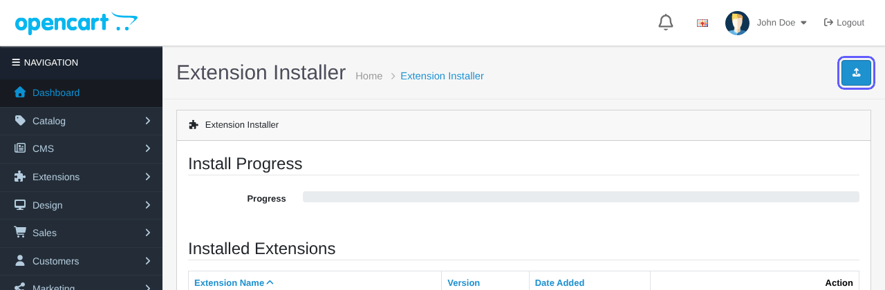
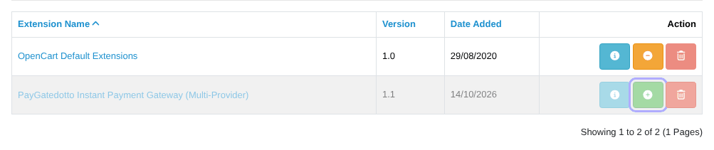
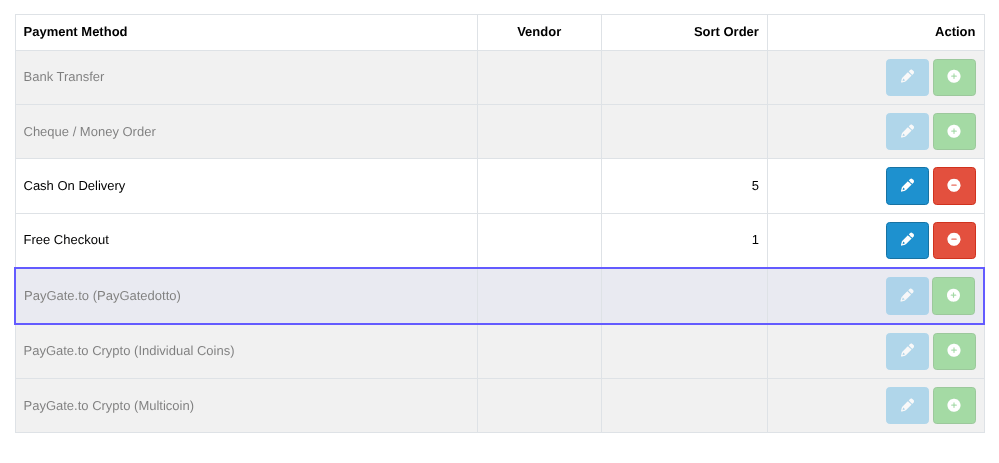
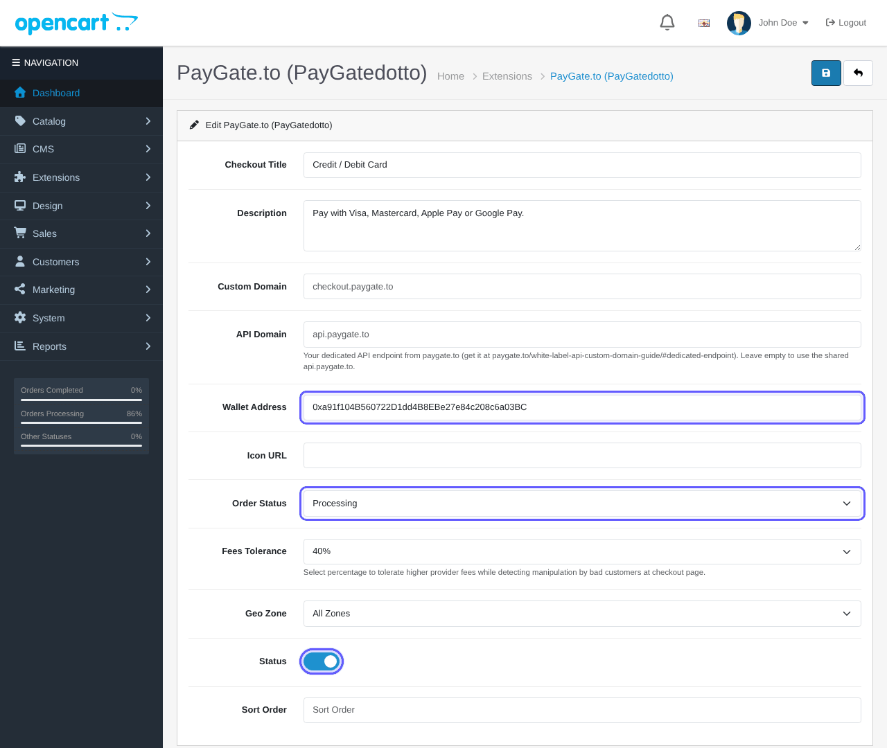
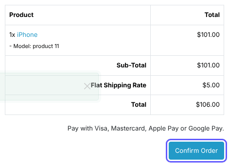
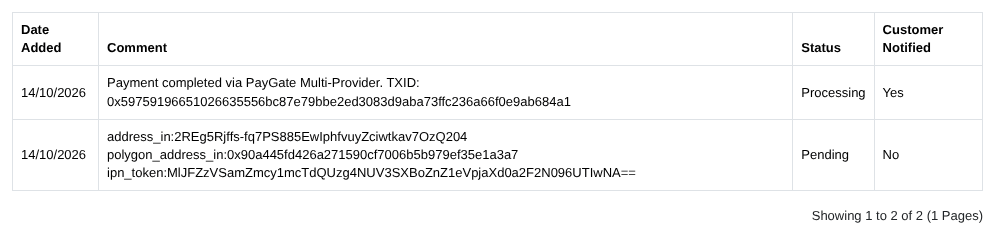

# OpenCart-Instant-Payment-Gateway
Instant OpenCart payment gateway to accept credit or debit cards or Google Pay or Apple Pay. Instant payouts to USDC wallet.

> 🪙 **Want crypto too?** Our free [OpenCart crypto module](https://paygate.to/crypto-payment-gateway-no-kyc-instant-payouts/opencart/) is the only crypto payment gateway with instant payouts for Solana, Monero, Zcash and Bitcoin.

## Features

- Accept **Visa, Mastercard, Apple Pay, Google Pay**, SEPA and local bank transfers.
- **Instant approval**: no sign up, no merchant account, no API keys and no KYC for you.
- **Instant payouts** to your own USDC (Polygon) wallet with every payment.
- **Zero chargebacks**: all payments are final.
- Multi-provider hosted payment page that picks the best provider for each customer's country.
- Payment confirmations signed by PayGate.to and verified by the module: orders are updated automatically.
- Works with your own checkout domain and a free dedicated API endpoint ([custom domain guide](https://paygate.to/white-label-api-custom-domain-guide/)).
- Fees: **1% + provider fees**.

📘 **Step-by-step guide with screenshots:** [https://paygate.to/instant-payment-gateway/opencart/](https://paygate.to/instant-payment-gateway/opencart/)

## Requirements

- **OpenCart 4.0.2.0 or newer** (OpenCart 3 is not supported)
- A public store (payment confirmations cannot reach localhost)
- A USDC (Polygon) wallet address

## Installation

1. **Get your payout wallet.** Card payments are paid out to a **USDC wallet on Polygon** (an address that starts with `0x`). Payouts may arrive as USDC, USDT (Polygon or BEP-20), ETH or POL, and the same address receives all of them. Use a **self-custodial wallet** you control (Trust Wallet, MetaMask, Rabby, a hardware wallet). **Never use an exchange deposit address**, and never paste the USDC token contract address.
2. **Download** [paygatedotto.ocmod.zip](https://github.com/paygate-to/OpenCart-Instant-Payment-Gateway/raw/refs/heads/main/paygatedotto.ocmod.zip). Keep the exact file name, and do not use GitHub's "Download ZIP" (that is the source, not the package).
3. In the admin open **Extensions › Installer**, click the blue **Upload** button and select the file, then click the green **+ Install** button.

   

   

4. Open **Extensions › Extensions**, choose **Payments**, install **PayGate.to (PayGatedotto)** with the green **+** and click the pencil to edit.

   

5. Fill in **Checkout Title**, paste your wallet into **Wallet Address**, check **Order Status** (preselected as **Processing**, the status for paid orders) and **Fees Tolerance** (40%), turn **Status** on and click **Save**.

   

6. **Test**: the customer selects the card method, clicks **Confirm Order** and pays on the secure payment page.

   

7. When the payment is confirmed the order moves from **Pending** to your **Order Status**, with the payout TXID in the history.

   

## Settings

| Setting | Description | Default |
|---|---|---|
| Checkout Title | Name of the method at checkout. Fill it in. | empty |
| Description | Text shown before Confirm Order. | empty |
| Custom Domain | Domain of the hosted payment page. | checkout.paygate.to |
| API Domain | Your dedicated API endpoint. | empty (uses api.paygate.to) |
| Wallet Address (required) | Your USDC (Polygon) payout address. | – |
| Order Status | Status set when the payment is confirmed. | Processing |
| Fees Tolerance | How far below the total a payment may be before the order is marked Failed (10–90%, or disabled). | 40% |
| Geo Zone, Status, Sort Order | Standard OpenCart options. | All Zones, off |

## Troubleshooting

- **Method not shown**: Status on, Geo Zone matches, Checkout Title filled.
- **"Invalid file type!"**: the zip was renamed; keep `paygatedotto.ocmod.zip`.
- **Order stays Pending**: the store must be public and not in maintenance mode.

Full product page: [https://paygate.to/instant-payment-gateway/](https://paygate.to/instant-payment-gateway/) · Support: [Telegram](https://t.me/PayGate_to)
